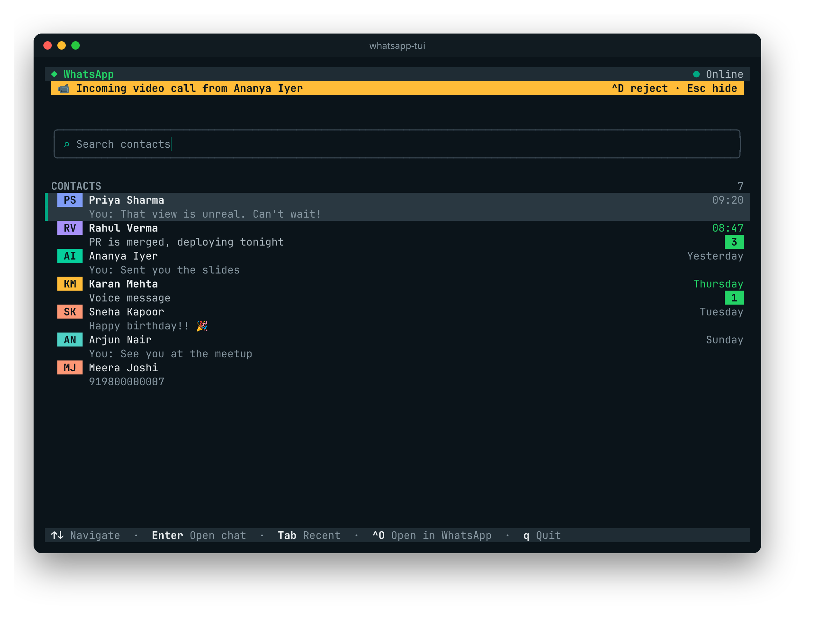
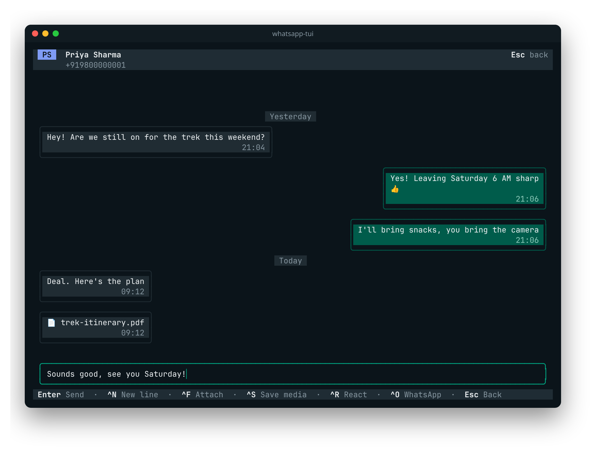
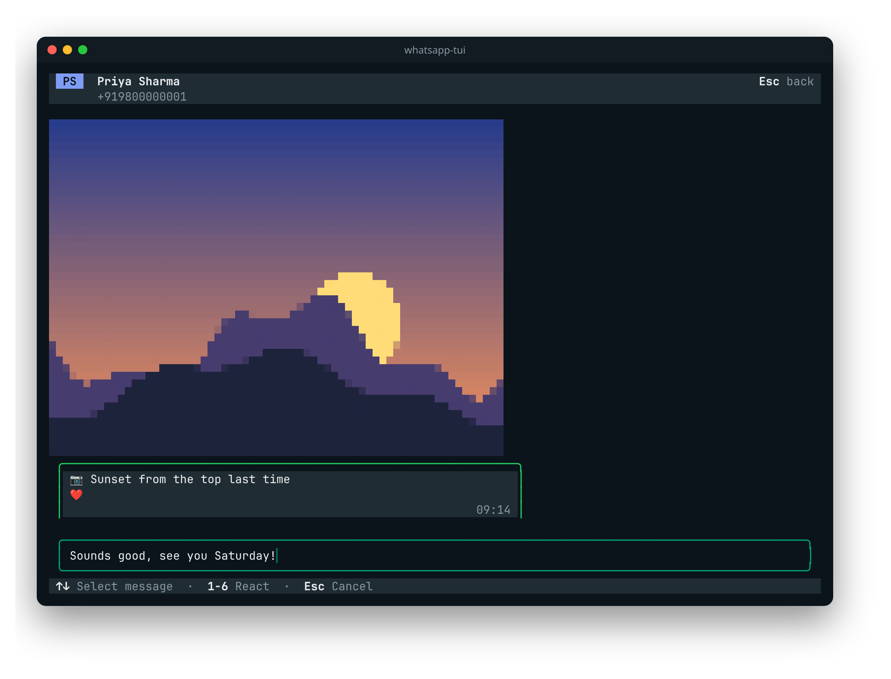

# WhatsApp TUI Messenger (Go + Bubble Tea)

[](https://golang.org/)
[](https://github.com/ashankgupta/whatsapp-tui/actions/workflows/ci.yml)
[](https://github.com/ashankgupta/whatsapp-tui/releases/latest)
[](LICENSE)


A terminal-based WhatsApp messenger built in Go using [whatsmeow](https://github.com/tulir/whatsmeow) and the [Bubble Tea](https://github.com/charmbracelet/bubbletea) TUI framework. Send messages and files directly from your terminal to WhatsApp contacts with ease.

---

## Features

- Real chat names from WhatsApp: names saved on your phone, group and channel titles and profile names
- Add, rename and delete contacts from inside the app; `contacts.json` is created automatically
- WhatsApp-style chat view with sent/received messages
- Edited and deleted messages update like in WhatsApp; locations, polls, contacts and events show as readable bubbles
- Inline image previews rendered with truecolor terminal blocks
- Save incoming images, documents and other media with `Ctrl+S`
- Send local files with `Ctrl+F` — images are sent as photos, everything else as documents
- Message reactions — see reactions under bubbles and react to any message with `Ctrl+R`
- Incoming WhatsApp call alerts with reject (`Ctrl+D`)
- Open a direct chat in WhatsApp desktop/web with `Ctrl+O`
- Persistent chat history stored locally in `history.db`
- Full session persistence in `session.db` (no re-scan after first login)
- Modern WhatsApp-inspired dark UI with avatars, chat bubbles and unread badges
- Smooth terminal UI with keyboard navigation
- Live incoming messages and unread counts (`Tab` to open chats, `/` to search them)
- Archived chats stay hidden and quiet, synced with your phone — archive or unarchive with `a`, view them with `v`
- QR-based login (session saved locally)
- Written entirely in Go (no browser or Node.js required)

---

## Screenshots

### Contacts and incoming calls


### Chat


### Inline images and reactions


*Screenshots use demo data.*

---


Runs on Linux, macOS, Windows and FreeBSD (x86_64 and arm64). Inline previews use truecolor ANSI blocks and look best in a modern terminal (Ghostty, Kitty, WezTerm, Alacritty, etc.).


## Installation

### Download a release (recommended)

Grab the archive for your platform from the [latest release](https://github.com/ashankgupta/whatsapp-tui/releases/latest):

| OS | File |
| --- | --- |
| Linux | `whatsapp-tui_<version>_Linux_x86_64.tar.gz` / `_arm64.tar.gz` |
| macOS | `whatsapp-tui_<version>_macOS_x86_64.tar.gz` (Intel) / `_arm64.tar.gz` (Apple Silicon) |
| Windows | `whatsapp-tui_<version>_Windows_x86_64.zip` / `_arm64.zip` |
| FreeBSD | `whatsapp-tui_<version>_Freebsd_x86_64.tar.gz` |

Linux packages are also available (`.deb`, `.rpm`, `.apk`, Arch `.pkg.tar.zst`):

```bash
sudo dpkg -i whatsapp-tui_<version>_amd64.deb   # Debian/Ubuntu
sudo rpm -i whatsapp-tui-<version>.x86_64.rpm   # Fedora/RHEL
```

On macOS, unsigned binaries are quarantined by Gatekeeper. Clear the flag once after extracting:

```bash
xattr -d com.apple.quarantine ./whatsapp-tui
```

Check your download against `checksums.txt` from the release:

```bash
sha256sum --ignore-missing -c checksums.txt
```

### Build from source

```bash
git clone https://github.com/ashankgupta/whatsapp-tui.git
cd whatsapp-tui
go build -o whatsapp-tui .
./whatsapp-tui
```

With `make` installed, `make run` builds and starts the app in one step (`make help` lists the other targets, such as `make windows` for a Windows `.exe`).

No C compiler is needed — SQLite is a pure-Go driver, so `CGO_ENABLED=0` builds work on every platform. Run `whatsapp-tui --version` to see the installed version.

### Contacts

You don't need to set anything up. On first run the app creates an empty `contacts.json` next to it, and chats show the names WhatsApp already knows: the names saved on your phone, group and channel titles, and people's own profile names (shown with `~`, like in WhatsApp).

Manage contacts from inside the app:

- **Contacts screen:** select **+ New contact** at the top of the list (or press `Ctrl+N`) to add someone by number with country code and a name. `Ctrl+E` renames the selected contact and `Ctrl+X` deletes it. Typing a number in the search box first fills it in for you.
- **Recent chats:** `s` saves the selected chat as a contact, prefilled with its WhatsApp name.
- **Chat:** `Ctrl+E` saves or renames the person you're talking to.

A name you save always takes priority over the WhatsApp name. Contacts are stored in `contacts.json` in this format, if you prefer to edit it by hand:

```json
[
  { "name": "Alice", "number": "919876543210" }
]
```

Numbers are in international format without `+` (e.g. `919876543210` for India). The app accepts `+`, spaces and dashes when you type a number and cleans them up for you.

## QR Code Login

#### 1. On first run, a QR code appears in your terminal.

#### 2. Open WhatsApp → Linked Devices → Link a Device.

#### 3. Scan the code.

#### 4. Your session is saved to `session.db` for reuse.

## Chat History & Receiving

Messages are saved locally in `history.db`, so conversations survive restarts. Open a contact with `Enter` to see its full history and reply in the same view. Incoming messages arrive live; press `Tab` for a list of recent chats. Reactions are shown under the relevant bubble and persist in `history.db`.

Connection diagnostics are appended to `whatsapp.log` so they do not interfere with the terminal UI.

Incoming images are downloaded automatically and shown inline. In terminals with Sixel graphics (foot, WezTerm, Konsole, xterm, iTerm2, Windows Terminal 1.22+, and tmux 3.4+ running in one of them) images are drawn at full resolution; elsewhere they fall back to truecolor half-blocks. Set `WHATSAPP_TUI_IMAGES=blocks` to always use half-blocks, or `WHATSAPP_TUI_IMAGES=sixel` to force Sixel when detection misses your terminal. Previews use the available chat width and height, and captions appear beneath the preview. Press `Ctrl+S` to save the latest downloadable media in the open chat. While reaction mode is active, `Ctrl+S` saves the selected message instead. Files are written to `downloads/` (gitignored).

Other incoming media types, such as videos, audio, stickers and documents, appear as labelled bubbles and can be saved on demand. Their original media metadata is stored in `history.db` so they can be re-downloaded later if needed. Images and files you send are cached in the local `media/` folder (gitignored). Images are limited to 16 MB for inline sending; larger images and all other file types are sent as documents.

Incoming WhatsApp calls appear as a banner. You can reject them with `Ctrl+D` or hide the alert with `Esc`. `whatsmeow` does not support starting or answering calls, so `Ctrl+O` opens the contact's chat in WhatsApp Desktop/Web where you can use the call button.

### Keyboard shortcuts

| Screen | Keys |
| --- | --- |
| Contacts | `↑/↓` navigate, `Enter` open chat, `Ctrl+N` new contact, `Ctrl+E` edit, `Ctrl+X` delete, `Tab` recent chats, `Ctrl+O` open in WhatsApp, `Esc` clear search, `q` quit |
| Chat | type to compose, `Enter` send, `Ctrl+N` new line, `Ctrl+F` attach a local file (type/paste path, `Enter` send, `Esc` cancel, `Ctrl+U` clear), `Ctrl+S` save latest media (selected media while reacting), `↑/↓` scroll, `Ctrl+R` react (`↑/↓` pick message, `1`–`6` choose emoji, same emoji again removes, `Esc` cancel), `Ctrl+E` save/rename contact, `Ctrl+O` open in WhatsApp, `Esc` back, `Ctrl+C` quit |
| Recent chats | `/` search by name or number (finds archived chats too; `Esc` closes), `↑/↓` navigate, `Enter` open, `s` save contact, `a` archive/unarchive, `v` show archived chats, `Tab` back, `Ctrl+O` open in WhatsApp, `q` quit |
| Call alert | `Ctrl+D` reject, `Esc` hide |

## Disclaimer

#### This project uses an unofficial WhatsApp Web API, which may stop working if WhatsApp changes its internal protocol. Use responsibly. This is meant for educational or personal use only.

## Contributing

Pull requests are welcome! If you have ideas for improvement, feel free to open an issue or PR.


## License

MIT License
© 2026 Ashank Gupta

